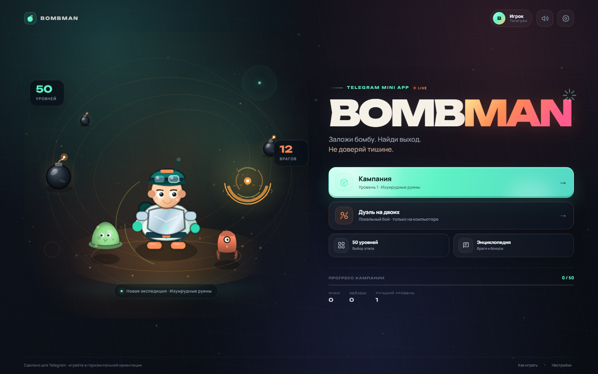
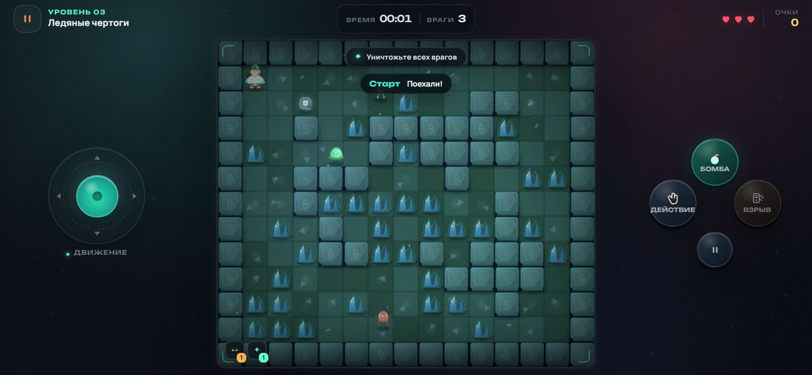
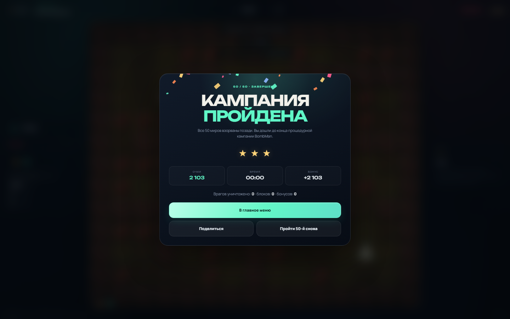
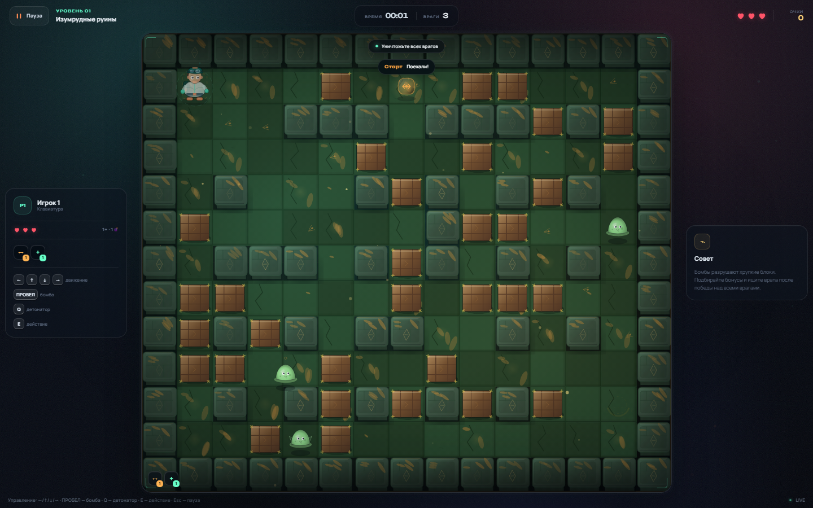

# BombMan

**BombMan** — полноценная Bomberman-игра для **Telegram Mini Apps**: 50 процедурных миров, 12 типов противников, 12 бонусов, ездовые животные, локальная дуэль на ПК и сенсорное управление для телефона.

Игра написана без фреймворков и без внешних ассетов: вся графика, палитры, музыка, звуки и уровни генерируются в браузере. Проект готов к размещению на любом HTTPS-хостинге и открытию как Telegram Mini App.



| Телефон | Финал кампании |
|---|---|
|  |  |



---

## Быстрый запуск

Нужен Node.js 18+.

**Самый простой способ на Windows:** дважды щёлкните **[START_BOMBMAN.bat](START_BOMBMAN.bat)**. Он запустит сервер и сам откроет игру в браузере. Чёрное окно сервера не закрывайте во время игры.

Либо вручную:

```bash
npm start
# → http://localhost:4173
```

Сборка не требуется — это статическое приложение с ES-модулями. Для публикации достаточно выложить содержимое папки на любой HTTPS-хостинг (Vercel, Cloudflare Pages, Netlify, собственный сервер).

Проверки:

```bash
npm run check           # 50 уровней + вся игровая логика, без браузера

# в другом терминале, при запущенном npm start:
npm run smoke           # браузерный smoke-тест интерфейса и touch-управления
```

Smoke-тест использует локальный Chrome и сохраняет скриншоты в `artifacts/`. При необходимости путь к браузеру задаётся через `CHROME_PATH`.

---

## Подключение к Telegram

1. Создайте бота у [@BotFather](https://t.me/BotFather): `/newbot`.
2. Разместите папку игры на HTTPS-домене. Telegram Mini Apps не работают по `http://` (кроме localhost).
3. В BotFather откройте `/newapp` (или `/setmenubutton`) и укажите URL игры.
4. Откройте Mini App из чата с ботом.

Для локальной проверки на телефоне можно использовать HTTPS-туннель (Cloudflare Tunnel, ngrok) и указать его URL в BotFather. Токен бота фронтенду не нужен: игра работает как обычная Mini App, если открыта из Telegram.

### Что делает интеграция

- `Telegram.WebApp.ready()` / `expand()`;
- запрос fullscreen и попытка блокировки ориентации на мобильном;
- haptic feedback;
- имя и аватар пользователя из Telegram;
- подтверждение закрытия во время игры;
- нативная кнопка «Назад»;
- шаринг финального результата.

Если игра открыта в обычном браузере, всё тоже работает — Telegram-функции просто отключаются.

---

## Управление

### Телефон

Игра открывается в горизонтальной ориентации. Если телефон в портрете, показывается анимированная подсказка «Поверните телефон».

- **Слева** — интерактивный стик движения.
- **Справа** — четыре кнопки: бомба, действие, детонатор, пауза.
- **Действие** контекстное: бросок бомбы, способность животного.
- Размер стика и кнопок настраивается: **S / M / L**.

### Компьютер

| Действие | Игрок 1 | Игрок 2 (дуэль) |
|---|---|---|
| Движение | стрелки | W A S D |
| Бомба | Space | F |
| Детонатор | Q | G |
| Действие | E | H |
| Пауза | Esc | Esc |

Все клавиши переназначаются в **Настройки → Управление**.

- Если назначить клавишу, которая уже принадлежит другому игроку, у второго игрока эта клавиша **снимается** и действие остаётся без назначения («—»).
- Внутри одного игрока занятую клавишу назначить нельзя, чтобы не потерять действие.

---

## Режимы

### Кампания — 50 миров

- 10 визуальных тем × 5 вариантов палитры = **50 уникальных миров**.
- Перед каждым уровнем заново генерируются арена, расстановка блоков, враги, бонусы, животные и погодные частицы.
- Фиксированными остаются название и палитра уровня — так проще запоминать миры и сравнивать результаты.
- Уровни открываются последовательно; в выборе уровней видны звёзды за время и лучший счёт.
- Все подобранные бонусы, броня, максимальные сердца и животное сохраняются и переносятся в следующий уровень. Прогресс снаряжения также сохраняется в `localStorage` между запусками.
- Каждый этап имеет 3 звезды, бонус за скорость и собственный процедурный саундтрек.
- Уничтожьте всех врагов, затем войдите в открывшиеся врата.

### Дуэль на двоих — только на компьютере

- Кнопка **«Дуэль на двоих»** появляется только на десктопе (включая Telegram Desktop). На телефоне её нет — там доступен только одиночный режим.
- Локальный бой на одном экране, два набора клавиш.
- Симметричная процедурная арена, бонусы и ловушки.
- Побеждает игрок, первым выигравший два раунда.

---

## Противники (12)

| # | Противник | Поведение |
|---|---|---|
| 1 | Слизень | медленно ходит случайно |
| 2 | Спринтер | быстро ходит случайно |
| 3 | Охотник | медленно, но целенаправленно ищет игрока |
| 4 | Броненосец | три взрыва ломают броню |
| 5 | Прыгун | прыгает по клеткам, может перепрыгнуть блок |
| 6 | Огнехвост | оставляет шлейф из трёх огненных клеток |
| 7 | Трус | убегает от игрока |
| 8 | Фантом | становится невидимым на 3 секунды |
| 9 | Искуситель | умный тактик: виляет, выжидает, делает рывок |
| 10 | Деляга | после смерти распадается на двух мини-слизней |
| 11 | Крот | уходит под землю, проходит сквозь блоки, атакует из-под земли |
| 12 | Страж | неподвижный турельный враг, стреляет во все стороны |

Каждый противник получает процедурный вариант окраски и деталей под палитру уровня.

---

## Бонусы (12)

| Бонус | Эффект |
|---|---|
| Мега-фитиль | +1 к радиусу взрыва |
| Дополнительная бомба | +1 к лимиту одновременных бомб |
| Детонатор | ручной подрыв бомб |
| Фазовый пояс | проход сквозь хрупкие блоки |
| Бомбомёт | бросок бомбы через стены |
| Сенсорный взрыватель | бомба взрывается при приближении |
| Пинок | бомба катится до препятствия |
| Огнеупорный костюм | свои бомбы не ранят |
| Доспехи | поглощают одно касание врага, визуально надеваются |
| Турбо-боты | +18% скорости за подбор |
| Магнит | притягивает бонусы в радиусе 3 клеток (кроме стен) |
| Перо Феникса | +1 сердце |

Дополнительно на аренах встречаются **яйца ездовых животных**: Кенгуру Ро (+скорость), Дракончик Пых (огненное дыхание), Светляк Люм (+радиус и подсветка). Животное принимает первый удар на себя.

---

## Классические механики и добавленные детали

Помимо перечисленного в задании, реализованы:

- ездовые животные с активными способностями;
- клеточное движение: персонаж всегда останавливается ровно в центре клетки и не может застрять на собственной бомбе;
- локальная дуэль для двух игроков на одном компьютере;
- процедурная погода и ambient-частицы для каждого мира;
- звёзды, рекорды, открытие уровней и выбор этапа;
- энциклопедия с описанием всех врагов, бонусов и животных;
- отдельная процедурная музыка для меню и каждого уровня;
- настройка громкости музыки и эффектов, размера сенсорных кнопок, качества частиц, тряски экрана и FPS;
- пауза по Esc/кнопке, авто-пауза при переключении вкладки;
- screen shake, вспышки, партиклы, разрушаемые блоки, цепные взрывы;
- адаптивная вёрстка под телефон, планшет и десктоп;
- безопасные зоны Telegram, fullscreen, ориентация, haptics;
- сохранение прогресса в `localStorage`.

---

## Структура проекта

```
Bomberman/
├─ index.html                  # экраны, HUD, меню, сенсорные контролы
├─ server.js                   # локальный статический сервер без зависимостей
├─ src/
│  ├─ main.js                  # приложение, экраны, модалки, настройки, поток игры
│  ├─ styles.css               # дизайн-система и адаптивная вёрстка
│  ├─ core/
│  │  ├─ audio.js              # процедурная музыка и синтезированные SFX
│  │  ├─ input.js              # клавиатура, стик, переназначение клавиш
│  │  ├─ rng.js                # seeded RNG и шум
│  │  ├─ storage.js            # сохранения, настройки, прогресс
│  │  ├─ telegram.js           # безопасная обёртка Telegram WebApp API
│  │  └─ utils.js              # математика, цвет, canvas-хелперы
│  └─ game/
│     ├─ catalog.js            # 12 врагов, 12 бонусов, темы, параметры
│     ├─ palette.js            # 50 уникальных палитр
│     ├─ level.js              # генератор арен, врагов, бонусов и животных
│     ├─ player.js             # движение, бонусы, здоровье, животные
│     ├─ enemy.js              # 12 моделей поведения
│     ├─ particles.js          # частицы, всплывающий текст, погода
│     ├─ art.js                # Canvas-спрайты героя, врагов, бомб, бонусов
│     ├─ renderer.js           # арена, процедурные тайлы, свет, постобработка
│     └─ game.js               # игровой цикл, бомбы, взрывы, портал, дуэль
└─ scripts/
   ├─ check.mjs                # проверка 50 уровней и игровой логики
   └─ smoke.mjs                # браузерный тест интерфейса и touch-управления
```

---

## Технические решения

- **Canvas 2D** вместо WebGL: стабильно работает в Telegram WebView на слабых телефонах, при этом использует кэширование статического пола, слоистые градиенты, additive-свет и партиклы.
- **Ноль внешних ассетов**: все текстуры, персонажи и иконки рисуются кодом, поэтому нет задержки загрузки и ломающихся путей.
- **Ноль npm-зависимостей**: проект запускается одним `node server.js`; хостинг — обычная статика.
- **Seeded procedural generation**: палитра и название уровня детерминированы, а планировка, враги и лут перегенерируются при каждом запуске уровня.
- **Без серверной части**: прогресс локальный. Для глобальных рекордов потребуется подключить backend.

---

## Ограничения

- Нет онлайн-мультиплеера: дуэль локальная, на одном компьютере.
- Прогресс хранится в браузере/Telegram WebView (`localStorage`), а не в облаке.
- Для запуска внутри Telegram требуется HTTPS-хостинг и настройка бота через BotFather.
- На iOS системная блокировка ориентации может быть недоступна; в этом случае остаётся полноэкранная подсказка повернуть устройство.

---

## Лицензия

Исходный код создан для проекта BombMan. Используйте и адаптируйте свободно.
